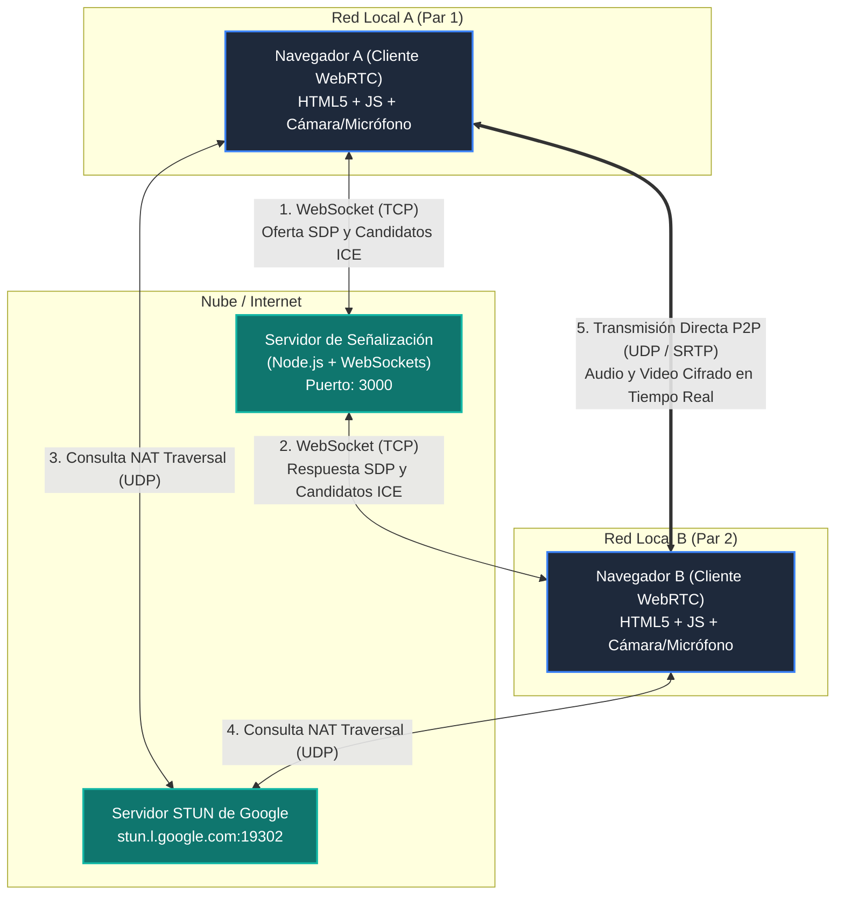
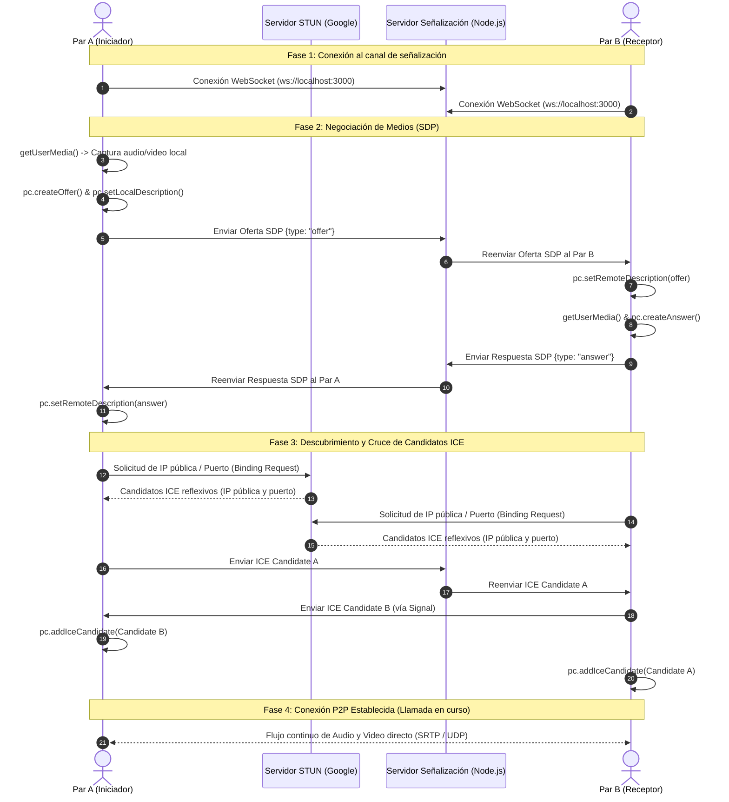
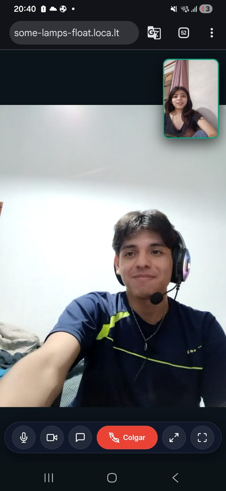
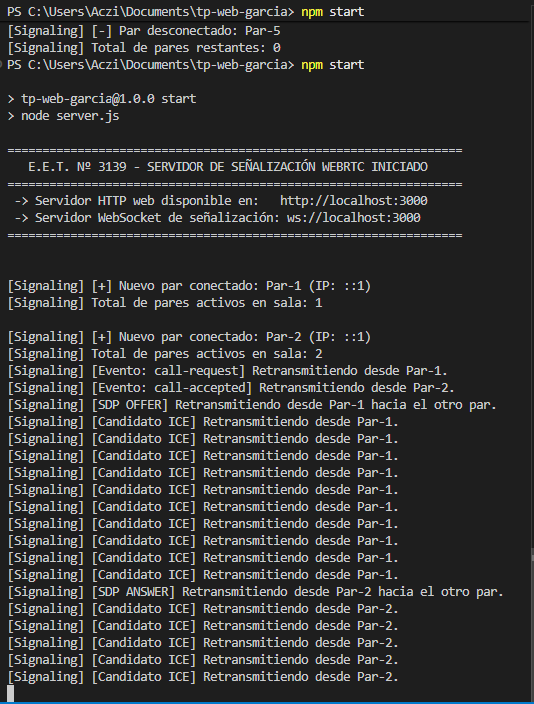

# Trabajo Práctico: Videollamada WebRTC Peer-to-Peer (P2P)

**Institución:** Escuela de Educación Técnica Nº 3139 “Gral. Martín M. de Güemes”  
**Ubicación:** Caseros Nº 1615 – Salta Capital  
**Materia / Especialidad:** Redes y Telecomunicaciones / Computación  
**Proyecto:** `tp-web-garcia`  
**Alumno / Integrantes:** García y equipo  
**Fecha:** Noviembre de 2026  

---

## 1. Descripción del Proyecto

Este trabajo práctico consiste en el diseño, desarrollo y documentación de una aplicación web de videollamada punto a punto (Peer-to-Peer) utilizando el estándar moderno **WebRTC** (*Web Real-Time Communication*).

A diferencia de las plataformas tradicionales basadas en streaming centralizado, WebRTC permite que dos navegadores web transmitan audio y video directamente entre sí sin que los flujos pesados de datos pasen por un servidor intermedio. Para hacer esto posible, se implementó también un **servidor de señalización** (*Signaling Server*) desarrollado en **Node.js** con soporte bidireccional mediante **WebSockets**.

---

## 2. Estructura del Repositorio

```text
tp-web-garcia/
├── .gitignore              # Filtro de exclusión para Git (node_modules, temporales)
├── package.json            # Manifiesto de dependencias de Node.js (librería ws)
├── server.js               # Servidor HTTP y servidor de señalización WebSocket (Punto 2)
├── index.html              # Interfaz de usuario con elementos <video autoplay> (Punto 1)
├── README.md               # Informe técnico completo del trabajo práctico (Punto 3)
├── css/
│   └── styles.css          # Estilos visuales: Dark Mode, Glassmorphism y diseño responsivo
├── js/
│   └── main.js             # Lógica cliente WebRTC: getUserMedia, RTCPeerConnection, STUN
└── docs/
    └── .gitkeep            # Directorio reservado para capturas de pantalla de la app
```

---

## 3. Documentación Técnica del Código

### Punto 1: Cliente WebRTC (`index.html`, `css/styles.css`, `js/main.js`)

1. **Elementos de Video HTML5 con Autoplay:**
   * `<video id="local-video" autoplay="autoplay" muted playsinline>`: Renderiza el flujo capturado por la cámara web del propio usuario en una miniatura flotante (*Picture-in-Picture*). Se le aplica el atributo `muted` para prevenir retroalimentación acústica (eco).
   * `<video id="remote-video" autoplay="autoplay" playsinline>`: Ocupa el contenedor principal para reproducir en tiempo real la transmisión recibida del par remoto.

2. **Captura de Periféricos (`getUserMedia`):**
   * Se solicita acceso al hardware mediante `navigator.mediaDevices.getUserMedia(mediaConstraints)` configurado con restricciones de alta definición (resolución ideal 1280x720 y audio estéreo).

3. **Configuración de Servidores STUN (`iceServers`):**
   * Se definen los servidores públicos de Google (`stun:stun.l.google.com:19302`) para resolver problemas de *NAT Traversal*. El servidor STUN permite que cada navegador averigüe su dirección IP pública y el puerto asignado por su enrutador.

4. **Ciclo de Vida de `RTCPeerConnection`:**
   * `pc.onicecandidate`: Evento que se dispara cada vez que el subsistema ICE del navegador descubre un nuevo candidato de conectividad (IP local, reflexiva STUN o relé). Cada candidato se empaqueta y se envía al otro par a través del canal de señalización.
   * `pc.onnegotiationneeded`: Detecta cuándo se añaden o modifican pistas multimedia locales. Genera automáticamente una oferta SDP (`pc.createOffer()`), la establece como descripción local (`pc.setLocalDescription()`) y la transmite al par remoto.
   * `pc.ontrack`: Se dispara al arribar las pistas de audio y video del par remoto, vinculando el flujo entrante (`event.streams[0]`) a `remoteVideoComponent.srcObject`.

5. **Controles de Usuario Integrados:**
   * Silenciar/activar micrófono dinámicamente (`toggleAudio()`).
   * Activar/desactivar la cámara web (`toggleVideo()`).
   * Visualización a pantalla completa (`toggleFullScreen()`).
   * Insignia de estado de red con animación luminosa para monitorear la conexión.

---

### Punto 2: Servidor de Señalización (`server.js`)

#### Justificación de la Tecnología Elegida
Se implementó el servidor de señalización con **Node.js**, integrando el módulo nativo **`http`** junto a la librería de alto rendimiento **`ws`** (WebSockets):
* **Conexión Persistente Full-Duplex:** Los WebSockets eliminan la latencia que introduce el sondeo periódico (*HTTP polling*), permitiendo reenviar ofertas, respuestas y candidatos ICE de forma instantánea mediante eventos.
* **Solución Autónoma Unificada:** Un único proceso en el puerto `3000` actúa simultáneamente como servidor web estático (sirviendo `index.html`, hojas de estilo y scripts) y como servidor de señalización en tiempo real.
* **Ligereza y Escalabilidad:** El consumo de memoria y procesamiento es mínimo, ideal para entornos escolares o de laboratorio.

#### Lógica de Retransmisión (*Broadcasting*):
1. Cuando un cliente se conecta, el servidor le asigna un identificador (`Par-1`, `Par-2`) y registra la conexión.
2. Al recibir un mensaje JSON (`desc` con una oferta o respuesta SDP, o `candidate` con una dirección ICE), el servidor recorre la lista de clientes activos y lo reenvía a la contraparte:
   ```javascript
   wss.clients.forEach((client) => {
     if (client !== ws && client.readyState === WebSocket.OPEN) {
       client.send(JSON.stringify(message));
     }
   });
   ```
3. Si un par cierra el navegador, el servidor detecta el evento `close` y notifica a los participantes restantes con un evento `peer-disconnected` para que liberen los recursos correspondientes.

---

## 4. Punto 3: Arquitectura, Diagramas y Conclusión Final

### Diagrama de Arquitectura de la Aplicación

El siguiente diagrama ilustra los tres canales de comunicación fundamentales que componen el sistema:
1. **Canal de Señalización (TCP / WebSockets):** Intercambio de metadatos SDP e ICE.
2. **Canal STUN (UDP):** Descubrimiento de direcciones IP públicas y resolución NAT.
3. **Canal Multimedia P2P Directo (UDP / SRTP / DTLS):** Flujo directo de audio y video cifrado punto a punto entre navegadores.



---

### Diagrama de Secuencia de Negociación WebRTC

Muestra la cronología exacta de eventos requerida para establecer la sesión P2P:



---

### Conclusión Final

La realización de este proyecto permitió comprender de manera práctica la arquitectura interna de las comunicaciones multimedia modernas en tiempo real:

1. **Independencia de la Capa de Señalización:**  
   Uno de los aciertos de diseño más importantes de la especificación WebRTC es haber desacoplado la señalización de la transmisión de medios. Esto brinda a los desarrolladores total flexibilidad para implementar la señalización mediante la tecnología más conveniente (en este caso, WebSockets con Node.js), mientras que el transporte de audio y video queda a cargo de canales UDP optimizados con protocolos SRTP (*Secure Real-time Transport Protocol*).

2. **Resolución de Barreras de Red (NAT y Cortafuegos):**  
   En las redes domésticas y escolares actuales, la escasez de direcciones IPv4 exige el uso de NAT (*Network Address Translation*), lo que impide que dos dispositivos dentro de redes privadas distintas conozcan su dirección pública mutua. El uso conjunto del protocolo ICE y de los servidores públicos STUN de Google resultó indispensable para sortear esta limitación, permitiendo que ambos extremos descubran sus rutas de conectividad válidas.

3. **Eficiencia, Privacidad y Rendimiento:**  
   Al ser una arquitectura descentralizada P2P, el servidor web únicamente consume recursos mínimos durante el apretón de manos inicial (*handshake*). Una vez establecida la llamada, el servidor de señalización queda completamente desocupado respecto a los paquetes de video. Esto no solo abarata drásticamente los costos de ancho de banda e infraestructura de red, sino que garantiza una latencia significativamente menor y un nivel superior de privacidad para los usuarios, ya que el video no se almacena ni pasa por servidores de terceros.

En conclusión, WebRTC representa una tecnología fundamental en el campo de las telecomunicaciones y el desarrollo de software, combinando estándares abiertos de la W3C e IETF para democratizar la transmisión de medios en tiempo real directamente desde el navegador y sin necesidad de complementos externos.

---

### Capturas de Pantalla de la Aplicación en Funcionamiento

> *Las capturas de pantalla de prueba deben guardarse en la carpeta `docs/` del repositorio.*

#### 1. Videollamada Activa entre Dos Pares
Muestra la conexión P2P establecida con ambos flujos de video (local y remoto) activos simultáneamente:



#### 2. Consola de Registro del Servidor de Señalización
Muestra el registro de eventos en la terminal de Node.js durante el intercambio de ofertas, respuestas y candidatos ICE:



---

## 5. Guía de Ejecución y Pruebas

### Prerrequisitos
* Tener instalado **Node.js** (versión 18 o superior).
* Navegador moderno compatible con WebRTC (Google Chrome, Microsoft Edge, Mozilla Firefox o Brave).

### Pasos para Ejecutar
1. Clonar el repositorio y acceder a la carpeta:
   ```bash
   git clone https://github.com/Aczino593/tp-web-garcia.git
   cd tp-web-garcia
   ```
2. Instalar dependencias:
   ```bash
   npm install
   ```
3. Iniciar el servidor:
   ```bash
   npm start
   ```
4. Abrir dos pestañas distintas del navegador en:
   ```text
   http://localhost:3000
   ```
5. En la primera pestaña, hacer clic en el botón **"Iniciar llamada"**.
6. Aceptar los permisos de cámara y micrófono en ambas pestañas para entablar la videollamada.
